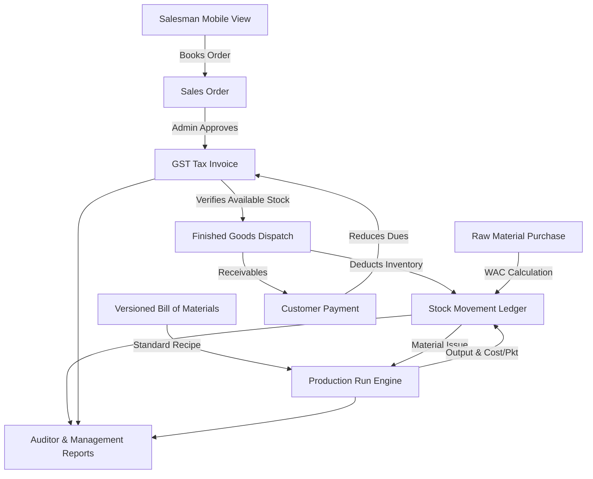
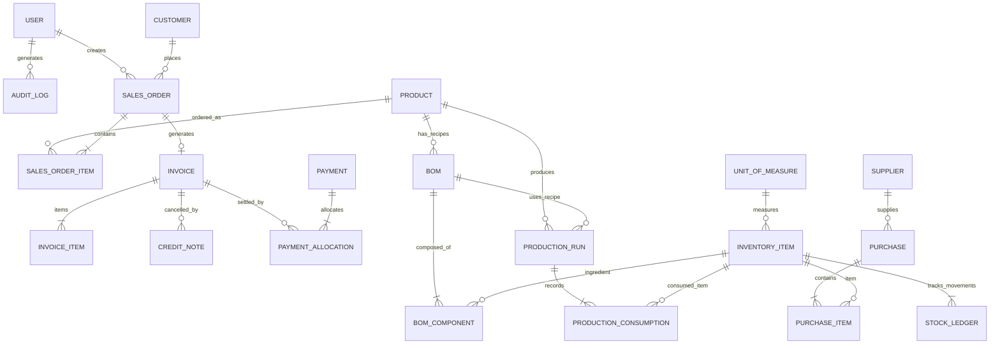

# SYSTEM DESIGN & ARCHITECTURE SPECIFICATION
## Order-to-Audit ERP for Packaged Food Manufacturing

### 1. Architecture Overview
The application is structured into decoupled, modular Django domain apps adhering to Clean Architecture and Domain-Driven Design (DDD):
- **apps.core**: Custom User model, Role-Based Access Control (RBAC), context processors, and immutable `AuditLog`.
- **apps.master_data**: Unit conversions, product specifications, customer/distributor profiles, vendor records, price books.
- **apps.inventory**: Relational double-entry style `StockLedger`, perpetual stock balance cache, Weighted-Average Costing (WAC) engine, purchase receipts.
- **apps.production**: Versioned Bill of Materials (BOM), recipe component ratios, batch execution engine, yield variance detection, and unit absorption costing.
- **apps.sales**: Sales orders, sequential GST tax invoicing (CGST/SGST vs IGST), controlled dispatch with stock verification, payment receipts, and lawful cancellation via credit notes.
- **apps.reports**: Statutory management summaries (GSTR-1, GSTR-3B), production costing sheets, receivables aging, CSV/Excel/PDF exporters.

---

### 2. Relational Entity-Relationship (ER) Diagram

---

### 3. Core Business Logic & Mathematical Formulas

#### A. Weighted-Average Valuation (WAC)
Applied upon every purchase receipt to ensure true inventory balance valuation:
$$\text{WAC}_{\text{new}} = \frac{(\text{Current Qty} \times \text{Current WAC}) + (\text{Purchase Qty} \times \text{Purchase Rate})}{\text{Current Qty} + \text{Purchase Qty}}$$
*Benchmark Verification:*
$$\frac{(100 \text{ kg} \times ₹42) + (60 \text{ kg} \times ₹45)}{160 \text{ kg}} = \frac{₹4,200 + ₹2,700}{160} = ₹43.1250/\text{kg}$$

#### B. Production Consumption & Yield Variance
Standard batch tolerance is configured at $3.0\%$.
1. **Material Consumption Variance %:**
$$\text{Consumption Variance \%} = \left(\frac{\text{Actual Quantity Consumed} - \text{Planned Quantity}}{\text{Planned Quantity}}\right) \times 100$$
*(Oil: 10.5 L actual vs 10 L planned = $+5.00\%$, flagged beyond $3\%$ tolerance)*

2. **Yield Variance %:**
$$\text{Yield Variance \%} = \left(\frac{\text{Actual Good Output} - \text{Expected Output}}{\text{Expected Output}}\right) \times 100$$
*(Benchmark: $(188 - 200)/200 \times 100 = -6.00\%$, flagged beyond $3\%$ tolerance)*

#### C. Packaging Capacity Warning
Outer cartons hold 20 packets each ($20\text{ pkts/carton}$). When $9\text{ cartons}$ are recorded for $188\text{ good packets}$, carton capacity is $9 \times 20 = 180\text{ packets}$.
The system records the actual 9 cartons, updates carton stock to 21, and flags:
> **Packaging Capacity Warning:** 9 cartons can hold 180 packets (at 20 pkts/carton), whereas actual good output is 188 packets (8 packets unboxed/overflow).

#### D. Production Costing & Unit Cost per Packet
$$\text{Total Production Cost} = \text{Direct Materials Cost} + \text{Direct Labour} + \text{Gas \& Power}$$
$$\text{Direct Materials} = ₹1,725 (\text{Flour}) + ₹1,470 (\text{Oil}) + ₹240 (\text{Spice}) + ₹485 (\text{Pouches}) + ₹135 (\text{Cartons}) = ₹4,055$$
$$\text{Total Cost} = ₹4,055 + ₹1,200 + ₹600 = ₹5,855$$
$$\text{Cost per Good Packet} = \frac{₹5,855}{188} = ₹31.1436 \approx ₹31.14$$

#### E. GST Invoicing Rules (Rule 46 Compliance)
- **Intra-State Supply (Tamil Nadu to Tamil Nadu):**
  - CGST: $2.5\%$
  - SGST: $2.5\%$
  - Tax on ₹7,500 = ₹187.50 CGST + ₹187.50 SGST = ₹375.00 (Total ₹7,875.00)
- **Inter-State Supply (Tamil Nadu to Karnataka):**
  - IGST: $5.0\%$
  - Tax on ₹6,000 = ₹300.00 IGST (Total ₹6,300.00)

#### F. Audit Trail & Immutability
- Invoices are never deleted from the database. Cancellations generate a formal `CreditNote`, recording audit reasons and restoring financial and inventory records.
- Database row-level locks (`select_for_update()`) ensure atomic stock balance updates and prevent race conditions or negative inventory.
